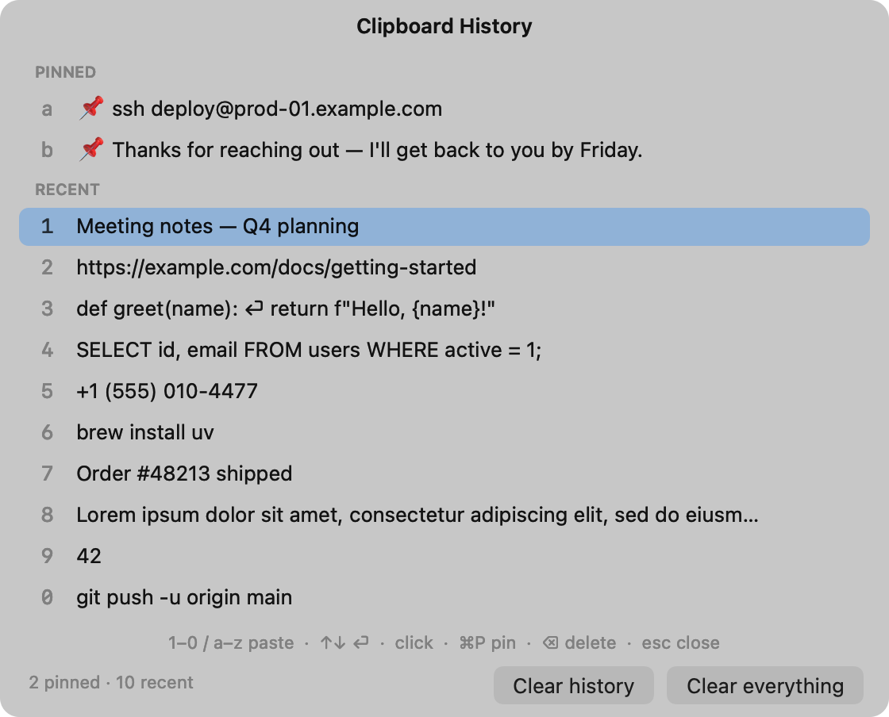

# clipmgr

A small macOS clipboard history manager. Keep using ⌘C / ⌘V as usual. When you
need something you copied earlier, press **⌥⌘V** in any app and pick it from a list.

<p align="center">
  <picture>
    <source media="(prefers-color-scheme: dark)" srcset="docs/screenshot-dark.png">
    
  </picture>
</p>

- Text only. The last **10** copies, plus any number of **pinned** items.
- Lives in the menu bar (no Dock icon).
- History is kept **in memory only**. Nothing is written to disk, and quitting clears it.
- Copies that password managers mark as concealed or transient
  (`org.nspasteboard.ConcealedType` / `TransientType`) are never recorded.

## Setup (one time)

You need macOS and [uv](https://docs.astral.sh/uv/) (`brew install uv`).

### 1. Install

Put the project somewhere outside Desktop, Documents and Downloads. macOS
restricts those folders for apps that start at login.

```sh
git clone https://github.com/pransil/clipboard-tool.git ~/devel/clipboard-tool
cd ~/devel/clipboard-tool
uv sync
```

### 2. Start it at login

```sh
scripts/login-item.sh install
```

This starts clipmgr now and every time you log in or restart the Mac. A clipboard icon
appears in the menu bar. macOS may show a "Background Items Added" notification;
that's expected. The script installs a per-user LaunchAgent
(`~/Library/LaunchAgents/local.clipmgr.plist`). It relaunches clipmgr if it
crashes, but not after you choose **Quit**.

<details>
<summary>Prefer to run it by hand instead?</summary>

```sh
uv run python -m clipmgr     # Ctrl+C or menu bar → Quit to stop
```

Started this way, it runs until you quit it or log out. In step 3, macOS lists
your **terminal app** (Terminal, iTerm, VS Code…) instead of "Python".
</details>

### 3. Allow it to paste into other apps (Accessibility)

The shortcut and the history work right away with no permissions. To paste the item
you pick into the app you were using, clipmgr sends ⌘V for you, and macOS requires
the **Accessibility** permission for that.

1. On first start, clipmgr shows a dialog. Click **Open Accessibility Settings**.
   You can also go to **System Settings → Privacy & Security → Accessibility**.
2. Turn on **Python**. If you started clipmgr from a terminal, turn on your terminal app instead.
   Usually macOS adds the entry when clipmgr asks. If Python isn't listed, click **+**,
   press ⌘⇧G, and paste the path from the "Accessibility app" line of
   `scripts/login-item.sh status`.
3. Run `scripts/login-item.sh restart`.

Until you do this, picking an item still copies it, and the menu bar shows
"Copied — press ⌘V".

clipmgr does **not** need Input Monitoring or Screen Recording.

### 4. Check it works everywhere

The shortcut is system-wide, so it doesn't matter which app, window or browser tab is in front.
Check a few places:

- [ ] **TextEdit:** press ⌥⌘V, then `1`. Your last copy is pasted.
- [ ] **A browser tab** (a search box, a Google Doc, a Gmail draft): same test.
- [ ] **A full-screen app**, and **another desktop (Space)**: the popup appears on top.
- [ ] **A second display**, if you have one: the popup opens on the display with the mouse pointer.
- [ ] **After a restart:** the menu bar icon is back without running anything.

## Use

Press **⌥⌘V** (or click the menu bar icon → Show Clipboard History).

| Key | Action |
|---|---|
| `1`…`9`, `0` | paste recent item 1…10 (1 = most recent copy) |
| `a`…`z` | paste a pinned item |
| ↑ ↓, then ⏎ | move, then paste the highlighted item |
| click | paste that item |
| ⌘P | pin / unpin the highlighted item |
| ⌫ | delete the highlighted item |
| esc, or ⌥⌘V again | close |
| right-click | Paste / Pin / Delete menu |

- **Clear history** removes unpinned items. **Clear everything** also removes pins.
  Both are in the popup and the menu bar menu.
- Picking an item moves it to the top of the recent list. Pinned items keep their place.
- Copying something already in the list moves it to the top instead of adding a duplicate.
- ⌥⌘V is also Finder's *Move Item Here* shortcut for files. While clipmgr is running, use
  Finder's **Edit** menu instead: hold ⌥ and choose **Move Item Here**.
- Pinned items don't count toward the 10-item limit. They stay until you unpin or delete them,
  or quit clipmgr.

## Configure

Optional: `~/.config/clipmgr/config.toml`

```toml
hotkey = "cmd+option+v"   # e.g. "ctrl+cmd+v", "cmd+shift+v", "f13"
poll_interval = 0.25    # seconds between clipboard checks (0.05–2.0)
```

Modifiers: `cmd`, `ctrl`, `option`/`alt`, `shift`. A hotkey must include `cmd` or `ctrl`
(F-keys excepted), because macOS rejects option-only shortcuts. This file holds
settings only, never clipboard contents. Run `scripts/login-item.sh restart` after editing it.

## Troubleshooting

| Problem | Fix |
|---|---|
| Popup opens but nothing is pasted | Accessibility is off for the entry that started clipmgr ("Python" at login, or your terminal app). Turn it on, then `scripts/login-item.sh restart`. |
| Auto-paste stopped after `brew upgrade` | Homebrew installed a new Python build, and macOS treats it as a new app. In Accessibility, remove the old **Python** entry (−), then `scripts/login-item.sh restart` and allow it again. |
| ⌥⌘V does nothing | Check for the menu bar icon. If it's missing, run `scripts/login-item.sh status`. If clipmgr showed "Couldn't register the shortcut", another app owns ⌥⌘V; pick a different `hotkey` in the config file. |
| ⌥⌘V doesn't work in one particular app | That app may use ⌥⌘V itself, or it may have turned on secure keyboard entry (password fields, Terminal → Secure Keyboard Entry), which can block shortcuts and synthesized keys. |
| Two clipboard icons in the menu bar | One copy started at login and another from a terminal. Quit the terminal one. |
| Not starting at login | In **System Settings → General → Login Items & Extensions**, under *Allow in the Background*, make sure the Python entry (it may be listed as `python3.14`) is on. Then run `scripts/login-item.sh install` again. If you moved the project folder, reinstall too. |
| Logs | `~/Library/Logs/clipmgr.log` (start/stop and errors only, never clipboard contents) |

To stop starting at login: `scripts/login-item.sh uninstall`.

## Develop

```text
src/clipmgr/
  history.py    filtering.py    watcher.py    config.py    display.py   # pure Python, unit-tested
  macos/        pasteboard.py   hotkey.py     paste.py     popup.py     app.py
tests/          unit tests for the pure modules (run anywhere)
scripts/        login-item.sh, copy_sensitive.py (manual test helper),
                render_screenshots.py (regenerates docs/screenshot-*.png)
```

```sh
uv run pytest
```

### Manual test checklist (macOS)

1. Copy 12 distinct lines in TextEdit, then press ⌥⌘V. Expect exactly 10 recent items, numbered 1–0.
   Pin one (⌘P), copy 12 more lines, and check that the pin is still there as `a`.
2. In TextEdit, press ⌥⌘V then `3`. The third item is pasted at the cursor and shows as `1` next time.
   Repeat with ↑↓ + ⏎, with a click, and with a letter for a pinned item.
3. Check ⌘P (unpin), ⌫ (delete), **Clear history** (pins remain), and **Clear everything** (empty).
4. Run `uv run python scripts/copy_sensitive.py`, then open the popup. The text must not appear.
   Repeat with `--transient`. Then copy a password from Passwords or 1Password, if one is installed.
5. Turn Accessibility off. Picking an item copies it and shows "press ⌘V". Turn it back on,
   restart clipmgr, and check that auto-paste works.
6. Gmail (user-supervised): paste into a draft from the popup. Check the text, **do not send**,
   then discard the draft.
7. Quit and relaunch. The history is empty.

## Known limitations (v1)

- Plain text only (no images, files, RTF/HTML). No sync, no persistence.
- Auto-paste sends the physical V key (ANSI key code 9). Non-QWERTY layouts such as Dvorak
  may paste the wrong shortcut.
- macOS shows the app as "Python" (or your terminal app) in Settings, not as "clipmgr".

## Phase 2 ideas

- Credential queue: copy a username and password, then paste them in order. Both are held
  in memory only and cleared after use or after 30–60 s. Never pinned, never in history.
- A real `.app` bundle (py2app) so clipmgr has its own name and icon in the Accessibility and
  Login Items lists.
